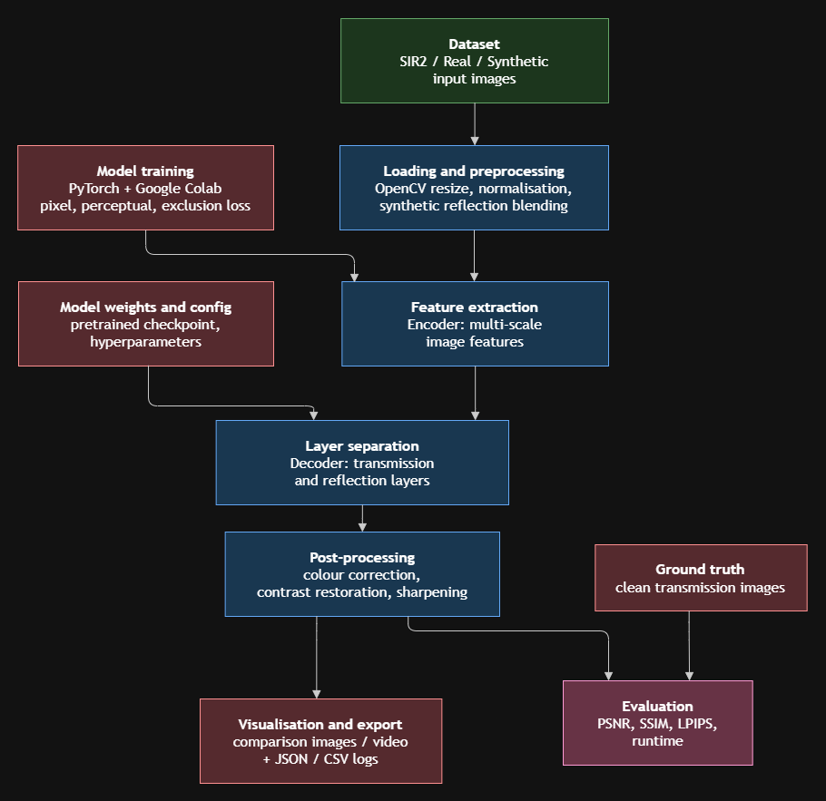

Eliminarea Reflxiilor din Imagini  
Costin Radu-Ionut  
Piazzo Elena

| Nr. | Autor(i) / An | Titlul articolului / proiectului  | Aplicatie / Domeniu | Tehnologii utilizate | Metodologie / Abordare | Rezultate | Limitari | Comentarii suplimentare |
| :---- | :---- | :---- | :---- | :---- | :---- | :---- | :---- | :---- |
| 1 | Renjie Wan, Boxin Shi, Haoliang Li,  Yuchen Hong,  Ling-Yu Duan,  Alex C. Kot,  | Benchmarking Single-Image Reflection Removal Algorithms  | Image restoration, Reflection removal, Computer vision | Nikon D5300, SSIM(r), SI, LPIPS, PSNR, NCC, LMSE   | Reflections classified into 4 categories: In-focus, Out-of-focus, Ghosting effect and low-transmitted reflections. Evaluated non-learning and deep-learning methods across indoor, outdoor and in-the-wild datasets. | Deep Learning models outperform non-learing methods High performance on out-of-focus reflections, but lower performance on in-focus reflections. Low performance on “in-the-wild’ and tinted glass. | Deep learning methods have degraded performance on unseen real-world scenarios.  Existing models fail to handle tinted glass or obscure / curved glass. |  |
| 2 | Qiming Hu, Xiaojie Guo | Single Image Reflection Separation via Component Synergy | Image processing, Computer Vision | Deep Learning, DSRNet, VGG-19  | The proposed DSRNet takes a single reflection- contaminated image and separates it using two cascaded network stages. It employs mutually gated feature interaction and multi-scale semantic fusion, while a learnable residue module captures nonlinear effects such as attenuation and overexposure during training.  | The method achieves an average PSNR of 25.40 dB and SSIM of 0.905 across four real-world benchmark datasets, outperforming the compared methods under the primary training setting. It also achieves improved visual separation of transmission and reflection layers, particularly in scenes with strong reflections and highlights.  | Performance depends on the training data and may degrade on unseen reflection conditions; the authors also note that further constraints on the residue term are needed to reduce its solution space and improve flexibility.  |  |
| 3 | Zhenbo Song, Zhenyuan Zhang, Kaihao Zhang, Wenhan Luo, Zhaoxin Fan, Wenqi Ren, Jianfeng Lu | Robust Single Image Reflection Removal Against Adversarial Attacks | Image processing, Computer Vision | Deep learning, Transformer Networks, Multi-Scale Feature Fusion, Cross-Scale Attention, Adversarial Training (PGD), GAN (Generative Adversarial Network)  | The methodology involves applying diverse adversarial attacks, specifically tailored for SIRR, using the Projected Gradient Descent (PGD) method.  | The proposed model improves robustness against adversarial attacks, achieving higher PSNR values than the WY19 baseline on both clean and perturbed images while preserving image restoration quality.  | Multiple modules make implementation and training more difficult as well as high computational cost, due to the model using transformer blocks and multiple processing scales.  |  |
| 4 | Mingjia Li, Jin Hu, Hainuo Wang, Qiming Hu, Jiarui Wang, Xiaojie Guo | Rectifying Latent Space for Generative Single-Image Reflection Removal | Computer vision, Image processing,  Reflection removal | FLUX.1 Kontext, VAE, Depth Anything V2, PyTorch | The authors observe that the latent space of pre-trained models does not respect the linear physics of reflection formation, so they introduce a re-VAE trained with an equivariance loss. They also use a learnable text embedding instead of ambiguous text prompts, and a sampling strategy called DEBS, which runs k trajectories for a single denoising step. | GenSIRR achieves state-of-the-art performance on all benchmarks . Human evaluation confirms the advantage (96.6% success rate on OpenRR-val versus 41.2% for DAI), and the ablations show that each component contributes significantly.  | The main limitation is latency: roughly 2–2.6 seconds per 256×256 image, compared to under 100 ms for RDNet and DAI. |  |
| 5 | Green Rosh, Pawan Prasad B H, Lokesh R Boregowda, Kaushik Mitra  | R2SFD: Improving Single Image Reflection Removal using Semantic Feature Dictionary  | Image processing, Reflection removal, Computer vision  | Deep learning, PyTorch, RAFENet (Reflection Aware Feature Extractor), SFDNet (Semantic Feature Dictionary Network), VGG, Cosine similarity, LSRR Dataset  | The proposed R²SFD framework uses a Coarse Semantic Search (CSS) to retrieve similar images from an external database and a novel RAFENet to build a Semantic Feature Dictionary (SFD) of reflection-invariant features. SFDNet then searches and transfers these semantic features to restore the transmission layer.  | The method achieves state-of-the-art qualitative and quantitative performance, outperforming existing methods on public datasets with an average PSNR of 26.26 dB and SSIM of 0.902, as well as on the proposed LSRR dataset with a PSNR of 25.18 dB and SSIM of 0.870.  | Retrieval efficiency from the Semantic Feature Dictionary depends heavily on the initial coarse search step to avoid high computational overhead, and feature matching accuracy can still be constrained by the diversity of the underlying external image database.  |  |

**Project Architecture**

The system is a modular pipeline designed for detecting and removing glass reflections from images, isolating the background transmission layer from the overlapping reflection layer. This architecture follows a structured flow similar to standard computer vision event detection and pose estimation systems.

The input consists of raw images or video frames degraded by reflections. The data is first passed through a loading and preprocessing module (using OpenCV/PIL) for resizing, normalization, and formatting. The core processing is handled by a Deep Learning Reflection Removal module (e.g., a CNN or GAN-based architecture), which utilizes pre-trained weights to predict and separate the transmission and reflection layers. The separated transmission image is then routed through an enhancement module to correct contrast and color degradation caused by the separation process. Finally, the results are exported as restored images alongside structured logs, and the pipeline's performance is quantitatively evaluated using standard image restoration metrics such as PSNR (Peak Signal-to-Noise Ratio) and SSIM (Structural Similarity Index) by comparing them against ground truth data.

